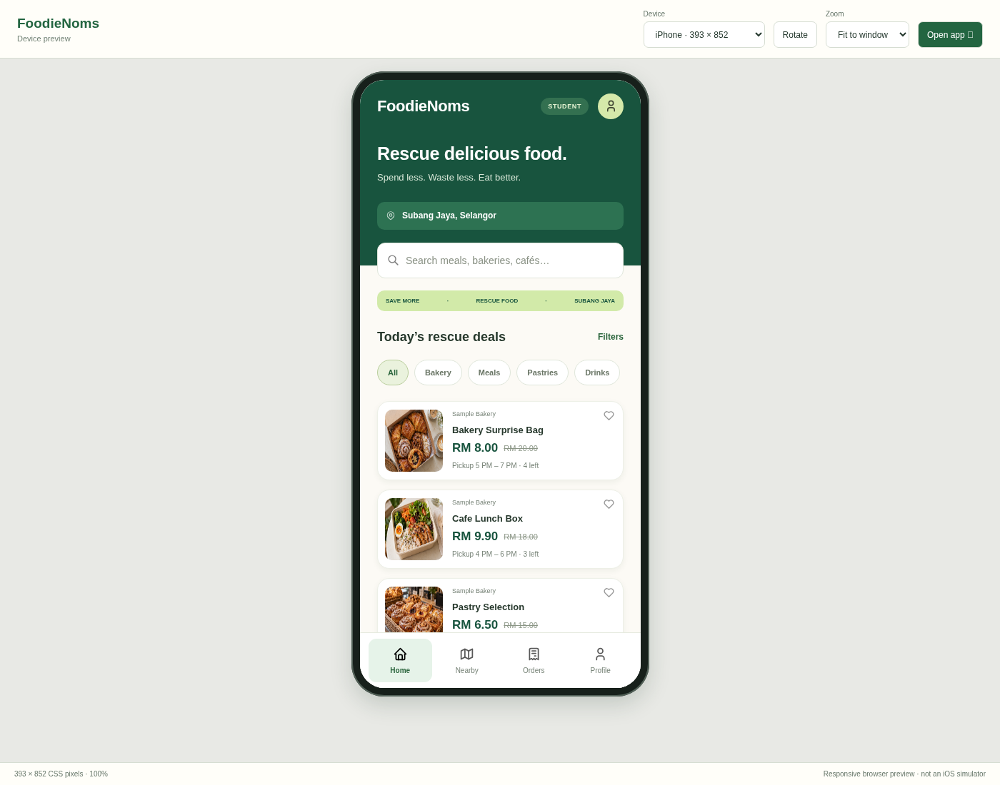

# FoodieNoms — fresh iPhone & iPad web app

The new application is in **[fresh-webapp/](fresh-webapp/)**. It is fresh HTML, CSS and JavaScript with responsive iPhone/iPad screens and isolated sample data.

**No Node.js, npm or Flutter is needed.**

## Open in VS Code

1. Download **[FoodieNoms-Fresh-Webapp.zip](https://github.com/Hollowlim/FoodieNoms/raw/refs/heads/main/FoodieNoms-Fresh-Webapp.zip)** and Extract All.
2. Open its **fresh-webapp** folder in VS Code. Trust this project folder if requested.
3. Install **Live Server by Ritwick Dey**.
4. Right-click **`preview.html` → Open with Live Server** to see the app inside an iPhone/iPad frame. Select a device and use **Rotate** to check landscape.
5. Right-click **`index.html` → Open with Live Server** for the actual app without the device preview.

If you download the whole repository instead, the root `index.html` and `preview.html` forward to the new project.

## Demo flows

Student signup/discovery/search/favourites, reservations and pickup pass; Vendor approval, listings and collection; Admin overview, vendors, moderation, reservations and reports.

**Admin demo login:** `admin123` / `admin@123`. Student and Vendor signups create local sample profiles. Authentication, payments and maps are demonstrations; data is not shared across devices.

See **[the full setup and iPhone installation guide](fresh-webapp/README.md)** for same-Wi-Fi testing and HTTPS Add to Home Screen. This delivers a web app, not an App Store/TestFlight native application. Browser device frames are layout previews, not iOS simulators.

Original logo/photo exports were not supplied. Static imagery uses the earlier recreated reference assets; the application code and data layer are new.

